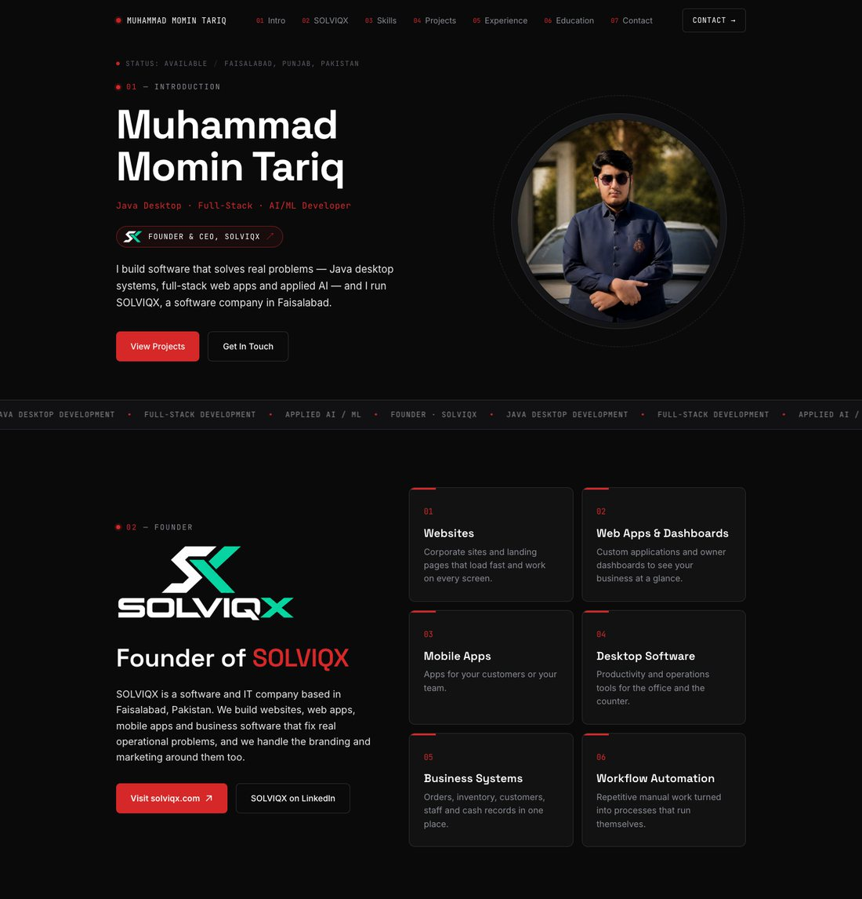

# Muhammad Momin Tariq — Portfolio

**Live site: [momin.solviqx.com](https://momin.solviqx.com)**

Personal portfolio of Muhammad Momin Tariq, a Java desktop, full-stack and AI/ML
developer from Faisalabad, Pakistan, and Founder & CEO of
[SOLVIQX](https://solviqx.com), a software and IT company.



## What is on the page

| # | Section | What it shows |
|---|---------|---------------|
| 01 | Intro | Name, role, photo and a link to SOLVIQX |
| 02 | Founder | SOLVIQX logo, short pitch and the six services it offers |
| 03 | Skills | Java desktop, full-stack, applied AI/ML, database and backend |
| 04 | Projects | Selected work, each linking to its repository or live demo |
| 05 | Experience | Founder & CEO at SOLVIQX, then internships at KolonX, DecodeLabs and Internee.pk |
| 06 | Education | BS Artificial Intelligence, The University of Faisalabad |
| 07 | Contact | GitHub, LinkedIn, email and solviqx.com, plus the footer |

## Selected projects

| Project | Stack |
|---------|-------|
| [CarCare](https://github.com/Momintariq-11/CarCare) — auto workshop management system | Java 21, Swing, FlatLaf, MySQL, JDBC |
| [Jinbo Order System](https://github.com/Momintariq-11/Jinbo-Order-System-MySQL) — e-commerce order engine | Java, MySQL, JDBC, GoF design patterns |
| [Intern Performance Prediction Model](https://intern-performance-prediction-model.vercel.app/) — live demo | Python, HTML, CSS |
| [AI Smart Blind Stick](https://github.com/Momintariq-11/AI-smart-blind-stick) | Arduino, C++, ultrasonic sensors |
| [FLEET-X](https://github.com/Momintariq-11/FLEET-X) — fleet management CLI | Java, OOP |
| [NovaBot](https://github.com/Momintariq-11/NovaBot-Rule-Based-AI-Chatbot) — rule-based chatbot | Python, Tkinter |
| [Data Classification Using AI](https://github.com/Momintariq-11/Data-classification-using-ai) | Python, Random Forest |
| [AI Recommendation Logic](https://github.com/Momintariq-11/AI-Recommendation-Logic) | Python |

## Design and motion

- Dark theme with a red, white, grey and black palette and a "systems console" feel.
- Hero content animates in on load.
- **Boxes assemble on scroll:** the SOLVIQX services, skills, projects, education
  and contact cards fly in from different directions and snap together, then
  replay when you scroll back up or down.
- Section headings and timeline rows slide in; the timeline line draws itself.
- A thin progress bar runs along the top of the page.
- Respects `prefers-reduced-motion` and works on phones, tablets and desktops.

The motion is plain CSS plus one `IntersectionObserver` in `src/App.jsx`. No
animation library is used.

## Tech stack

- React 18 and Vite 5
- Plain CSS (no UI framework)
- Cloudflare Workers (static assets) for hosting

## Run it locally

Requires Node.js 20 or newer.

```bash
npm install
npm run dev        # http://localhost:5173
npm run build      # production build into dist/
npm run preview    # preview the production build
```

## Edit the content

Everything on the page comes from `src/data.js`: profile, socials, skills,
projects, experience, education and the SOLVIQX founder block. Change the text
there and the page updates; no component needs touching.

## Deployment

The site is hosted on **Cloudflare Workers** at
[momin.solviqx.com](https://momin.solviqx.com) and **redeploys automatically
on every push to `main`**.

- `wrangler.jsonc` serves the built `dist/` folder as static assets, with a
  single-page-app fallback.
- Build command: `npm run build`. Deploy command: `npx wrangler deploy`.
- The custom domain `momin.solviqx.com` is attached to the Worker in the
  Cloudflare dashboard.

`vercel.json` is kept so the project can also be hosted on Vercel if needed
(framework preset **Vite**, output directory `dist`).

## Project structure

```
├── index.html
├── wrangler.jsonc          Cloudflare Workers config
├── vercel.json             optional Vercel config
├── docs/preview.jpg        screenshot used in this README
├── public/images/
│   ├── profile.jpg         portrait used on the page
│   ├── profile-icon.png    favicon
│   └── solviqx-*.png       SOLVIQX logo, wordmark and mark
└── src/
    ├── main.jsx
    ├── App.jsx             page layout, scroll observer, progress bar
    ├── App.css             component styles and animations
    ├── index.css           design tokens (colours, fonts, base styles)
    ├── data.js             all editable content
    └── components/
        ├── Navbar.jsx
        ├── Hero.jsx
        ├── Founder.jsx     SOLVIQX section
        ├── Skills.jsx
        ├── Projects.jsx
        ├── Experience.jsx
        ├── Education.jsx
        └── Contact.jsx     socials and footer
```

## Links

- Portfolio: [momin.solviqx.com](https://momin.solviqx.com)
- SOLVIQX: [solviqx.com](https://solviqx.com)
- GitHub: [@Momintariq-11](https://github.com/Momintariq-11)
- LinkedIn: [Muhammad Momin Tariq](https://www.linkedin.com/in/muhammad-momin-tariq-4b1b95369)
